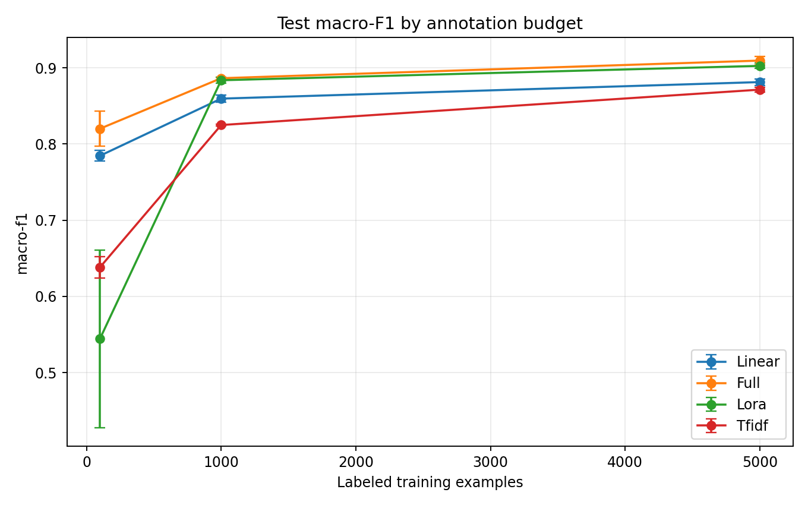
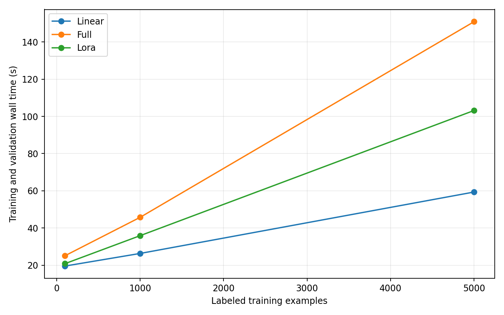
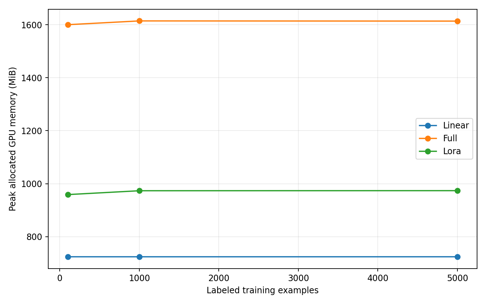

# Transformer Fine-Tuning & Data Efficiency

**An empirical study of linear probing, full fine-tuning, and LoRA on AG News**

This project benchmarks the adaptation of **DistilBERT** to four-class news classification under three labeled-data budgets: **100, 1,000, and 5,000 examples**. It compares the frozen-encoder linear probing baseline, full fine-tuning, and low-rank adaptation (LoRA), alongside a traditional **TF-IDF + logistic regression** baseline.

**Status: completed experiments** · 27 Transformer training runs + 9 TF-IDF runs · 3 seeds (42, 123, 2027) · 7,600 held-out test examples · Tesla T4 GPU.

## Research question

*How do labeled data availability and adaptation strategy affect classification accuracy, macro-F1 and computational costs?*

## Held-out test results

**Macro-F1, mean ± sample standard deviation over three random seeds:**

| Method | 100 | 1,000 | 5,000 |
|---|---:|---:|---:|
| Full fine-tuning | 0.8200 ± 0.0232 | 0.8863 ± 0.0016 | 0.9095 ± 0.0056 |
| LoRA | 0.5442 ± 0.1165 | 0.8837 ± 0.0038 | 0.9026 ± 0.0034 |
| Linear probing | 0.7845 ± 0.0071 | 0.8595 ± 0.0050 | 0.8813 ± 0.0044 |
| TF-IDF + logistic regression | 0.6381 ± 0.0138 | 0.8249 ± 0.0010 | 0.8713 ± 0.0031 |



The corresponding **accuracy** and per-run results are in [`results/summary_clean.csv`](results/summary_clean.csv) and [`results/all_metrics.csv`](results/all_metrics.csv). Scores above are **test**, not validation results.

### Main findings

- **Full fine-tuning** produced the highest mean test macro-F1 in all three studied data regimes, including **0.9095 ± 0.0056** at 5,000 examples.
- **LoRA nearly matched full fine-tuning at 1,000 examples**: **0.8837 ± 0.0038** versus **0.8863 ± 0.0016**, training **150,532 parameters** rather than **66,365,956** (approximately **441× fewer** trainable parameters).
- With **5,000 examples**, LoRA reached **0.9026 ± 0.0034**, versus **0.9095 ± 0.0056** for full fine-tuning. At this budget, training-and-validation wall time averaged **103.2 s** for LoRA and **150.9 s** for full fine-tuning on the recorded T4 runs. These are **observed run times**, not controlled model-speed benchmarks.
- **LoRA underperformed badly at 100 examples**: **0.5442 ± 0.1165** macro-F1, below both linear probing (**0.7845 ± 0.0071**) and TF-IDF (**0.6381 ± 0.0138**). This is not an omitted outlier: the fixed three-epoch LoRA setup appears poorly suited to this low-data regime; the experiment alone does not establish the precise cause.
- TF-IDF trains rapidly but trails the Transformer methods at 1,000 and 5,000 examples. Its parameter count has a **different interpretation** from the neural models and is not directly comparable.

## Experimental protocol

| Component | Setting |
|---|---|
| Dataset | AG News; 4 topics (World, Sports, Business, Sci/Tech) |
| Base model | `distilbert/distilbert-base-uncased` |
| Data splits | 2,000 stratified validation examples sampled from official train; official 7,600-example test left held out |
| Training budgets | 100 / 1,000 / 5,000; balanced across classes and nested **within each seed** |
| Seeds | 42, 123, 2027 |
| Token length | 128 |
| Batch size / epochs | 16 / 3 |
| Learning rate | Linear probe 1e-3; full fine-tuning 2e-5; LoRA 2e-4 |
| LoRA | Rank 8, alpha 16, dropout 0.1, attention modules `q_lin` and `v_lin` |
| Classifier | Same trainable 768-to-4 linear head architecture for all Transformer approaches |
| Model selection | Best validation macro-F1 across 3 epochs |
| Baseline | TF-IDF (1-2 grams, max 30,000 features) + logistic regression |
| Test metrics | Accuracy and macro-F1 per run; mean and sample std across seeds |
| Runtime | Google Colab Tesla T4; Python 3.13.16, PyTorch 2.11.0+cu130 |

All three methods were evaluated under the same **data budgets and epoch count**, but not the same number of trainable parameters or the same optimizer learning rate. The seeds affect both subset selection and model initialization. This is an applied benchmark, not a randomized causal comparison of training algorithms at equal compute.

## Computational trade-offs





For the 5,000-example setting, approximate means (three runs):

| Method | Trainable parameters | Training + validation time | Peak allocated GPU memory |
|---|---:|---:|---:|
| Linear probing | 3,076 | 59.4 s | 724 MiB |
| Full fine-tuning | 66,365,956 | 150.9 s | 1,614 MiB |
| LoRA | 150,532 | 103.2 s | 974 MiB |

Memory refers to the PyTorch **peak allocated** GPU memory, not total GPU consumption. Wall-clock time includes training and validation, excludes environment setup, and is subject to system variability.

## Files

```text
.
├── README.md
├── project.py                     # Re-runnable training/evaluation script
├── requirements.txt
├── .gitignore
├── docs/
│   ├── protocol.md                # Original experimental protocol
│   ├── findings.md                # Interpretation and limitations
│   ├── reproducibility.md         # Run instructions and caveats
│   └── cv_bullets.md              # Defensible resume phrasing
├── tests/
│   ├── test_protocol.py
│   └── test_result_integrity.py
└── results/
    ├── all_metrics.csv
    ├── test_results.csv
    ├── validation_runs.csv
    ├── validation_history.csv
    ├── experiment_config.json
    ├── sample_indices.json
    ├── summary_mean_std.csv       # Original experiment export
    ├── summary_clean.csv          # Clean recomputed summary
    ├── accuracy_vs_samples.png
    ├── macro_f1_vs_samples.png
    ├── training_time.png
    └── gpu_memory.png
```

No notebook (`.ipynb`), raw AG News texts, or model checkpoints are published. The source code is included for re-execution. **The exported CSV files are not sufficient to regenerate individual model predictions or exact checkpoints; those require rerunning the training pipeline.**

## Reproducing the study

Use a CUDA-enabled Python environment (the original runs used Google Colab T4), then:

```bash
python -m pip install -r requirements.txt
python -m pytest -q tests
python project.py --phase pilot
python project.py --phase full
python project.py --phase test
python project.py --phase plots
```

If PEFT fails to import because Colab preinstalls an incompatible `torchao`, uninstall that **optional** dependency (`python -m pip uninstall -y torchao`) and restart **only if necessary** before beginning a fresh run.

**Important:** the pipeline stores intermediate checkpoints under `/content/transformer-finetuning-data-efficiency` by default. For new runs, use a persistent runtime or adjust `USE_GOOGLE_DRIVE` inside `project.py` before execution; Colab sessions are temporary. See [`docs/reproducibility.md`](docs/reproducibility.md).

## Scope and limitations

The benchmark is exploratory: one English classification dataset, one pretrained checkpoint, three seeds, fixed learning rates and three training epochs. The fixed LoRA setting may be undertrained at 100 examples. The observed differences cannot be generalized into statistically proven algorithmic superiority, and this study makes no inference from the test set to select hyperparameters.

This repository documents a **machine learning research portfolio**, not a peer-reviewed paper. The original test results were computed from the fixed experimental pipeline; reproduced results can vary with software/hardware nondeterminism.
